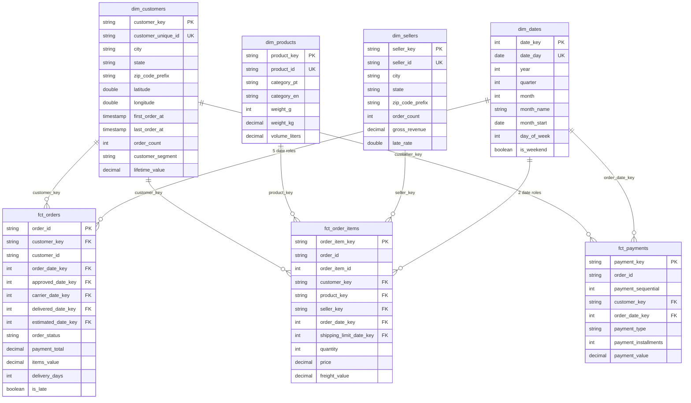
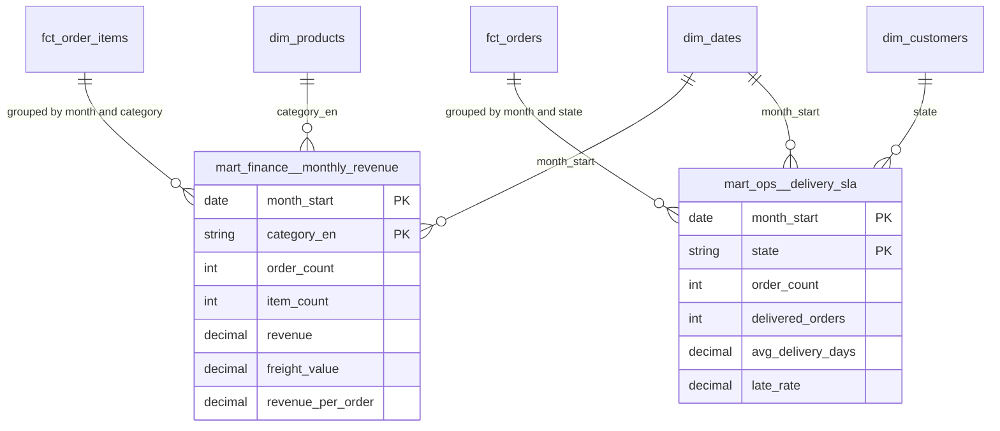

# Entity relationship diagram

Two views of the marts: the star that holds the dimensional core, and the aggregates built on top of it. Cardinality reads as `one dimension row` to `many fact rows`.

---

## 1. Star schema

---

## 2. Aggregates

Both aggregates are keyed by the pair in their `PK` rows, which is what their `unique_combination_of_columns` tests assert.

---

## 3. Foreign key map

| Fact | Column | Dimension | Note |
|---|---|---|---|
| `fct_orders` | `customer_key` | `dim_customers.customer_key` | |
| `fct_orders` | `order_date_key` | `dim_dates.date_key` | purchase date |
| `fct_orders` | `approved_date_key` | `dim_dates.date_key` | role 2, `0` when payment was never approved |
| `fct_orders` | `carrier_date_key` | `dim_dates.date_key` | role 3, `0` when never handed to the carrier |
| `fct_orders` | `delivered_date_key` | `dim_dates.date_key` | role 4, `0` for the 2,965 orders never delivered |
| `fct_orders` | `estimated_date_key` | `dim_dates.date_key` | role 5, the promised date |
| `fct_order_items` | `customer_key` | `dim_customers.customer_key` | |
| `fct_order_items` | `product_key` | `dim_products.product_key` | |
| `fct_order_items` | `seller_key` | `dim_sellers.seller_key` | |
| `fct_order_items` | `order_date_key` | `dim_dates.date_key` | purchase date |
| `fct_order_items` | `shipping_limit_date_key` | `dim_dates.date_key` | role 2, the seller's deadline |
| `fct_payments` | `customer_key` | `dim_customers.customer_key` | |
| `fct_payments` | `order_date_key` | `dim_dates.date_key` | proxy: payments carry no timestamp, so the order date is used |

Every one of these is covered by a `relationships` test, so a key that stops resolving fails the build.

---

## 4. Reading notes

- **Degenerate dimensions.** `order_id`, `order_item_id` and `payment_sequential` live in the facts without a dimension table.
- **Unknown member.** `date_key = 0` in `dim_dates` (dated 1900-01-01) is what the null lifecycle dates point at, so no foreign key is ever null.
- **No snowflake.** Category attributes sit inside `dim_products`; latitude and longitude sit inside `dim_customers` and `dim_sellers`. Each dimension joins the fact in one hop.
- **Surrogate keys** are md5 hashes of the natural key, except `date_key`, which is the integer `YYYYMMDD`.
- **Derived attributes.** `order_count`, `lifetime_value`, `gross_revenue` and `late_rate` are refreshed on every build. Kimball allows them in a dimension when queries need them; a stricter star would move them into periodic snapshot facts.
