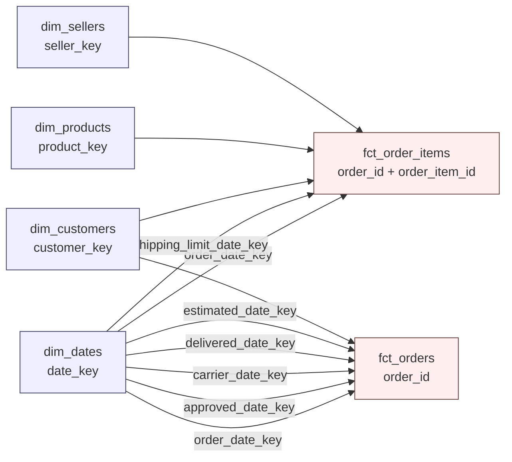

# Kimball dimensional model

The marts layer follows Kimball's four-step process for each business process, uses conformed dimensions, surrogate keys, and role-playing date dimensions. Staging and intermediate keep dbt's layering conventions; Kimball applies from the marts down.

---

## 1. The four-step process, applied

| Step | Order line process | Order fulfilment process |
|---|---|---|
| 1. Select the business process | Every product line sold on an order | The lifecycle of an order from purchase to delivery |
| 2. Declare the grain | One row per order line (`order_id`, `order_item_id`) | One row per order (`order_id`) |
| 3. Identify the dimensions | order date, shipping limit date, customer, product, seller | five order lifecycle dates, customer, order status |
| 4. Identify the facts | price, freight, quantity, late flag | item count and value, payment total, delivery duration, days late, review score |

Fact tables: `fct_order_items` (transaction fact, 112,650 rows) and `fct_orders` (accumulated snapshot fact, 99,441 rows).

---

## 2. Bus matrix and requirements

### 2.1 Bus matrix

`X` marks a dimension used by the fact table. A bracket names a role-playing date; every date column is a role.

| Business process | Fact table | date | customer | product | seller | status | Built |
|---|---|---|---|---|---|---|---|
| Order line (transaction) | `fct_order_items` | X (2 roles) | X | X | X | | yes |
| Order fulfilment (accumulated snapshot) | `fct_orders` | X (5 roles) | X | | | X | yes |
| Payment (transaction) | `fct_payments` | X (order date as proxy) | X | | | X (payment type) | yes |
| Review (transaction) | `fct_reviews` | X | X | X | X | X (score) | no |

`fct_reviews` stays unbuilt on purpose: the review grain is `review_id`, and nothing downstream has needed it yet. It becomes worth building the moment someone asks a question that mixes reviews with seller or product performance at the review grain.

### 2.2 Requirements matrix

Business questions mapped to the model that answers them. A new model is justified only when the **grain**, the **process combination** or the **pre-aggregation need** changes; a different slice of an existing fact is a dashboard filter.

**Already answered**

| Question | Grain | Source | Model |
|---|---|---|---|
| Monthly revenue and its trend | month × category | `fct_order_items`, `dim_products`, `dim_dates` | `mart_finance__monthly_revenue` |
| Delivery performance by state | month × state | `fct_orders`, `dim_customers`, `dim_dates` | `mart_ops__delivery_sla` |
| Which orders are late, with drill-down | order | `fct_orders` | `fct_orders`, exported as Parquet |
| Who is a repeat customer, and what they are worth | customer | `dim_customers` | `dim_customers` |

**Built from this matrix**

| Question | Grain | Source | Model |
|---|---|---|---|
| Which sellers need intervention | seller | `fct_order_items`, `fct_orders`, `dim_sellers` | `mart_seller__performance` |
| Does lateness drive bad reviews | month × is_late | `fct_orders`, `dim_dates` | `mart_cx__review_delivery` |
| Payment method and installment mix | month × payment_type | `fct_payments`, `dim_dates` | `mart_finance__payment_mix` |

**Next candidates**

| Question | Grain | What it would take |
|---|---|---|
| Which products and sellers draw bad reviews | review | A review-grain fact: reviews are currently aggregated to order grain, so product and seller attribution is approximate |
| Do first-time buyers come back | first order month × customer | A cohort model: first order month per customer, then activity by month offset |

**Deliberately not building**

| Question | Why not |
|---|---|
| Revenue by state or by category | Same fact sliced by another dimension. A dashboard filter does it, and a new model would fork the definition |
| Customer geography map | `dim_customers` already carries state and coordinates |
| Review text sentiment | No text tooling here, and free text carries personal data |
| Seller cancellation rate | Belongs inside the seller scorecard above, not in its own table |

### 2.3 Detailed implementation bus matrix

The bus matrix says which business processes exist. This one pins every physical table to a
grain sentence, its facts and their additivity, which is what an ETL developer or a reviewer
actually needs. A row here is a table, not a process.

| Table | One row is | Facts, by additivity | Degenerate dimensions |
|---|---|---|---|
| `fct_order_items` | one order line | additive: `price`, `freight_value`, `quantity` | `order_id`, `order_item_id` |
| `fct_orders` | one order | additive: `item_count`, `items_value`, `freight_value`, `payment_total`. Non-additive: `delivery_days`, `days_to_approve`, `days_to_carrier`, `days_late`, `latest_review_score` | `order_id` |
| `fct_payments` | one payment against an order | additive: `payment_value`. Semi-additive: `payment_installments` | `order_id` |
| `fct_orders_customer_geography` | one order, with two states attached | none: attributes only, no measures | `order_id` |

The marts are aggregates over these tables. Every rate a mart publishes ships with its
numerator and denominator (`late_orders` alongside `delivered_orders`, not only `late_rate`),
so the ratio can be rebuilt after summing. Averaging a stored rate across months is the error
that rule prevents.

## 3. Star schemas

No snowflaking: category attributes live inside `dim_products`, and latitude/longitude live inside `dim_customers` and `dim_sellers` rather than in a shared geography table. A separate `dim_geography` would be a conformed outrigger; it is listed as a next step, not adopted, because only two dimensions need it and flattening keeps single-join queries.

---

## 4. Key conventions

**Surrogate keys.** Every dimension has a single-column surrogate key as its primary key, and the source identifier as an alternate key:

| Dimension | Primary key | Alternate key |
|---|---|---|
| `dim_customers` | `customer_key` (md5 of `customer_unique_id`) | `customer_unique_id` |
| `dim_products` | `product_key` (md5 of `product_id`) | `product_id` |
| `dim_sellers` | `seller_key` (md5 of `seller_id`) | `seller_id` |
| `dim_dates` | `date_key` (integer `YYYYMMDD`) | `date_day` |

Hashes are used rather than sequences because dbt builds dimensions in a single statement with no sequence to draw on, and the hash is deterministic, so a rebuild produces the same key. The trade-off is 32 bytes instead of 4; at this data volume it does not matter, and it is stated here rather than glossed over.

**Degenerate dimensions.** `order_id` and `order_item_id` stay in the fact tables with no dimension table, which is Kimball's treatment for identifiers that have no attributes of their own.

**Role-playing date dimensions.** `dim_dates` is joined five times to `fct_orders`, once per lifecycle event. Each gets its own foreign key: `order_date_key`, `approved_date_key`, `carrier_date_key`, `delivered_date_key`, `estimated_date_key`. `fct_order_items` plays two roles: `order_date_key` and `shipping_limit_date_key`.

**Unknown members.** `dim_dates` carries a `date_key = 0` row dated 1900-01-01. Any lifecycle event that has not happened yet maps to key 0 instead of null, so every foreign key in a fact table is non-null and inner joins are safe. 2,965 orders have no delivery date and use key 0.

Entity dimensions have no unknown member because the data was checked: all 99,441 `customer_id` values exist in the customer table, and every `product_id` and `seller_id` in order lines resolves. Adding a `-1` row now would be ceremony; if a future source can have orphans, add it.

---

## 5. Dimension specifications

| Dimension | Grain | Descriptive attributes | SCD policy |
|---|---|---|---|
| `dim_customers` | one row per person (`customer_unique_id`) | city, state, zip, latitude, longitude, first and last order date, order count, one-time vs repeat | Type 1 in this table; Type 2 history is captured by `snapshots/customers_snapshot.sql`, a check-strategy snapshot on city, state and zip |
| `dim_products` | one row per product | English and Portuguese category, weight, dimensions, volume | Type 1 |
| `dim_sellers` | one row per seller | city, state, zip, latitude, longitude | Type 1 |
| `dim_dates` | one row per calendar day plus the unknown member | year, quarter, month, month name, day of month, day of week, day name, weekend flag | static |

`dim_customers` and `dim_sellers` also carry measures (order count, revenue, late rate). Kimball allows derived attributes in a dimension when every query needs them, provided they are refreshed on each build and documented. That is the position taken here; the alternative, a separate seller performance fact, is noted in section 7.

### 5.1 Design worksheets

One row per attribute, with the SCD policy decided at design time. This is the first step of a
source-to-target mapping: it says what each column is, where it comes from, and what happens
when the source value changes.

**`dim_customers`**

| Attribute | Type | SCD policy | Source |
|---|---|---|---|
| `customer_key` | surrogate, md5 of `customer_unique_id` | new version only when geography changes, in the snapshot | built |
| `customer_unique_id` | durable key | never changes, identifies the person across orders | source |
| `state`, `city`, `zip_code_prefix` | attribute | Type 2 in `snapshots/customers_snapshot.sql`, Type 1 in this table | source |
| `latitude`, `longitude` | attribute | Type 1 | geolocation aggregate |
| `first_order_at`, `last_order_at`, `order_count`, `lifetime_value`, `avg_order_value`, `avg_review_score` | derived attribute | Type 1, recomputed every build | derived from facts |
| `customer_segment` | derived attribute | Type 1, recomputed | derived from `order_count` |

**`dim_products`**

| Attribute | Type | SCD policy | Source |
|---|---|---|---|
| `product_key` | surrogate, md5 of `product_id` | stable | built |
| `product_id` | durable key | never changes | source |
| `category_pt`, `category_en` | attribute | Type 1, `category_en` resolved through the translation seed | source plus seed |
| `weight_g`, `length_cm`, `height_cm`, `width_cm`, `volume_cm3` | attribute | Type 1 | source |

**`dim_sellers`**

| Attribute | Type | SCD policy | Source |
|---|---|---|---|
| `seller_key` | surrogate, md5 of `seller_id` | stable | built |
| `seller_id` | durable key | never changes | source |
| `city`, `state`, `zip_code_prefix` | attribute | Type 1 | source |
| `latitude`, `longitude` | attribute | Type 1 | geolocation aggregate |

**`dim_dates`**

Every calendar attribute (day, month, quarter, weekday name, weekend flag) is Type 0: it never
changes once loaded. The key is a smart key, `yyyymmdd`, which Kimball exempts from the
surrogate-key rule, plus one unknown member at `date_key = 0`.

---

## 6. Fact specifications

**`fct_order_items`, transaction fact**

- Grain: one row per order line
- Foreign keys: `customer_key`, `product_key`, `seller_key`, `order_date_key`, `shipping_limit_date_key`
- Degenerate dimensions: `order_id`, `order_item_id`
- Measures, additive: `price`, `freight_value`, `quantity` (always 1 by construction, kept so summing quantity is legal)
- Flags: `is_late`

**`fct_orders`, accumulated snapshot fact**

- Grain: one row per order
- Foreign keys: `customer_key`, and five date keys for purchase, approval, carrier handover, delivery and the promised date
- Degenerate dimension: `order_id`
- Descriptive in-fact attribute: `order_status`
- Measures: `item_count`, `items_value`, `freight_value`, `payment_total` (additive); `delivery_days`, `days_to_approve`, `days_to_carrier`, `days_late` (non-additive durations); `latest_review_score` (non-additive)
- Flags: `is_delivered`, `is_late`

Duration and score measures are semi- or non-additive: summing `delivery_days` across orders is meaningless, averaging is not. This is stated in the column descriptions.

**`fct_orders_customer_geography`, order-grain view**

- Grain: one row per order
- Why it exists: `dim_customers` is one row per person, so any state rollup answers "where does this person live now", not "where was this order shipped"
- `person_state` comes from `dim_customers`; `order_state` comes from the customers snapshot keyed by `customer_id`, which in Olist is order-scoped
- `state_differs_from_person` flags the orders where the two disagree: 43 of 99,441 when measured
- Type 2 caveat: the source has no change timestamp, so a snapshot version's `dbt_valid_from` is the run that first saw the row, not a business date. The view takes the earliest recorded version and cannot reconstruct a state that changed before the snapshot existed

---

## 7. Deliberate deviations and next steps

1. **Measures in dimensions.** `order_count`, `lifetime_value`, `gross_revenue` and `late_rate` sit in the entity dimensions as derived attributes. A stricter star moves them into periodic snapshot facts (`fct_customer_monthly`, `fct_seller_monthly`). Worth doing if reporting demands period-over-period comparison.
2. **Reviews are the one process without a fact table.** `fct_payments` now exists at `order_id` + `payment_sequential`; reviews would sit at `review_id` with the same four dimensions. Nothing downstream needs that grain yet, so it stays in the bus matrix as unbuilt rather than half-built.
3. **No junk dimension.** Low-cardinality flags (`is_late`, `is_delivered`) stay in the fact. A junk dimension combining payment type, status and flags would be the textbook move once three or more such flags accumulate.
4. **Type 2 history lives in a snapshot, not in the mart.** `dim_customers` is Type 1 and overwritten on each build; `snapshots/customers_snapshot.sql` keeps the version history with `dbt_valid_from` and `dbt_valid_to`. Joining a fact to the snapshot on `customer_id` and the order timestamp answers "which state was this customer in when they ordered".
5. **Geography is approximated at person level.** `mart_ops__delivery_sla` and the order feed group by the state on `dim_customers`, one row per person. 43 of 99,441 orders carry a different state on the order itself than on the person, 0.043%, guarded by `assert_state_attribution_mismatch_bounded`. Repointing those marts at `fct_orders_customer_geography` would fix those 43 and is the next step if state-level reporting ever becomes material.
6. **Casing and naming.** Model names stay plural (`dim_customers`, `fct_orders`) for consistency with the existing project; Kimball's own convention is singular (`dim_customer`).
