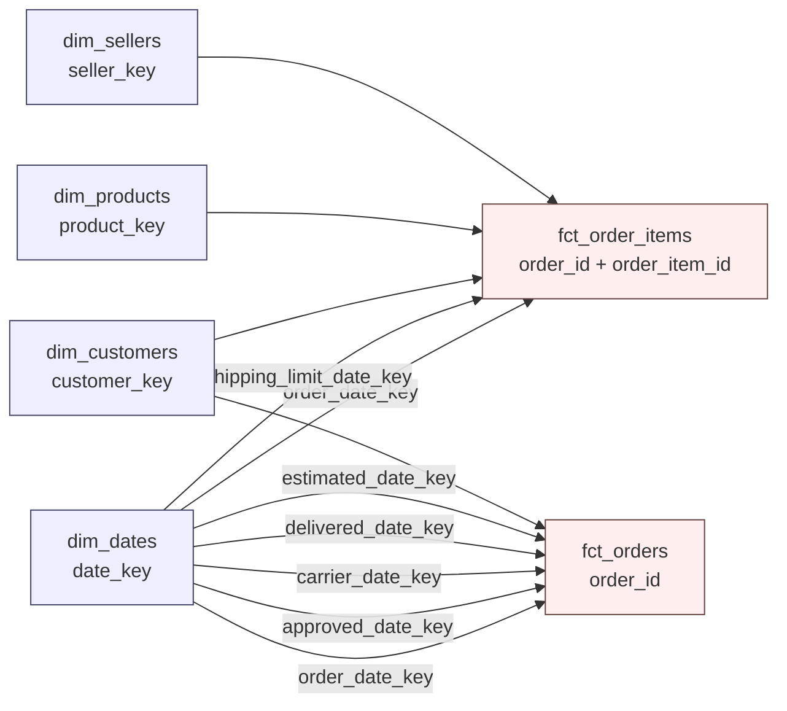

# Kimball dimensional model

The marts layer follows Kimball's four-step process for each business process, uses conformed dimensions, surrogate keys, and role-playing date dimensions. Staging and intermediate keep dbt's layering conventions; Kimball applies from the marts down.

---

## 1. The four-step process, applied

| Step | Order line process | Order fulfilment process |
|---|---|---|
| 1. Select the business process | Every product line sold on an order | The lifecycle of an order from purchase to delivery |
| 2. Declare the grain | One row per order line (`order_id`, `order_item_id`) | One row per order (`order_id`) |
| 3. Identify the dimensions | order date, shipping limit date, customer, product, seller | five order lifecycle dates, customer, order status |
| 4. Identify the facts | price, freight, quantity, late flag | item count and value, payment total, delivery duration, days late, review score |

Fact tables: `fct_order_items` (transaction fact, 112,650 rows) and `fct_orders` (accumulated snapshot fact, 99,441 rows).

---

## 2. Bus matrix

`X` marks a dimension used by the fact table.

| Business process | Fact table | date | customer | product | seller | status |
|---|---|---|---|---|---|---|
| Order line | `fct_order_items` | X (2 roles) | X | X | X | |
| Order fulfilment | `fct_orders` | X (5 roles) | X | | | X |
| Payments | `fct_payments` (planned) | X | X | | | X (junk) |
| Reviews | `fct_reviews` (planned) | X | X | X | X | |

Conformed dimensions are shared by key, not by copy: `dim_customers.customer_key` means the same customer in every fact.

---

## 3. Star schemas

No snowflaking: category attributes live inside `dim_products`, and latitude/longitude live inside `dim_customers` and `dim_sellers` rather than in a shared geography table. A separate `dim_geography` would be a conformed outrigger; it is listed as a next step, not adopted, because only two dimensions need it and flattening keeps single-join queries.

---

## 4. Key conventions

**Surrogate keys.** Every dimension has a single-column surrogate key as its primary key, and the source identifier as an alternate key:

| Dimension | Primary key | Alternate key |
|---|---|---|
| `dim_customers` | `customer_key` (md5 of `customer_unique_id`) | `customer_unique_id` |
| `dim_products` | `product_key` (md5 of `product_id`) | `product_id` |
| `dim_sellers` | `seller_key` (md5 of `seller_id`) | `seller_id` |
| `dim_dates` | `date_key` (integer `YYYYMMDD`) | `date_day` |

Hashes are used rather than sequences because dbt builds dimensions in a single statement with no sequence to draw on, and the hash is deterministic, so a rebuild produces the same key. The trade-off is 32 bytes instead of 4; at this data volume it does not matter, and it is stated here rather than glossed over.

**Degenerate dimensions.** `order_id` and `order_item_id` stay in the fact tables with no dimension table, which is Kimball's treatment for identifiers that have no attributes of their own.

**Role-playing date dimensions.** `dim_dates` is joined five times to `fct_orders`, once per lifecycle event. Each gets its own foreign key: `order_date_key`, `approved_date_key`, `carrier_date_key`, `delivered_date_key`, `estimated_date_key`. `fct_order_items` plays two roles: `order_date_key` and `shipping_limit_date_key`.

**Unknown members.** `dim_dates` carries a `date_key = 0` row dated 1900-01-01. Any lifecycle event that has not happened yet maps to key 0 instead of null, so every foreign key in a fact table is non-null and inner joins are safe. 2,965 orders have no delivery date and use key 0.

Entity dimensions have no unknown member because the data was checked: all 99,441 `customer_id` values exist in the customer table, and every `product_id` and `seller_id` in order lines resolves. Adding a `-1` row now would be ceremony; if a future source can have orphans, add it.

---

## 5. Dimension specifications

| Dimension | Grain | Descriptive attributes | SCD policy |
|---|---|---|---|
| `dim_customers` | one row per person (`customer_unique_id`) | city, state, zip, latitude, longitude, first and last order date, order count, one-time vs repeat | Type 1. A Type 2 version belongs in a snapshot when the business needs history of address changes |
| `dim_products` | one row per product | English and Portuguese category, weight, dimensions, volume | Type 1 |
| `dim_sellers` | one row per seller | city, state, zip, latitude, longitude | Type 1 |
| `dim_dates` | one row per calendar day plus the unknown member | year, quarter, month, month name, day of month, day of week, day name, weekend flag | static |

`dim_customers` and `dim_sellers` also carry measures (order count, revenue, late rate). Kimball allows derived attributes in a dimension when every query needs them, provided they are refreshed on each build and documented. That is the position taken here; the alternative, a separate seller performance fact, is noted in section 7.

---

## 6. Fact specifications

**`fct_order_items`, transaction fact**

- Grain: one row per order line
- Foreign keys: `customer_key`, `product_key`, `seller_key`, `order_date_key`, `shipping_limit_date_key`
- Degenerate dimensions: `order_id`, `order_item_id`
- Measures, additive: `price`, `freight_value`, `quantity` (always 1 by construction, kept so summing quantity is legal)
- Flags: `is_late`

**`fct_orders`, accumulated snapshot fact**

- Grain: one row per order
- Foreign keys: `customer_key`, and five date keys for purchase, approval, carrier handover, delivery and the promised date
- Degenerate dimension: `order_id`
- Descriptive in-fact attribute: `order_status`
- Measures: `item_count`, `items_value`, `freight_value`, `payment_total` (additive); `delivery_days`, `days_to_approve`, `days_to_carrier`, `days_late` (non-additive durations); `latest_review_score` (non-additive)
- Flags: `is_delivered`, `is_late`

Duration and score measures are semi- or non-additive: summing `delivery_days` across orders is meaningless, averaging is not. This is stated in the column descriptions.

---

## 7. Deliberate deviations and next steps

1. **Measures in dimensions.** `order_count`, `lifetime_value`, `gross_revenue` and `late_rate` sit in the entity dimensions as derived attributes. A stricter star moves them into periodic snapshot facts (`fct_customer_monthly`, `fct_seller_monthly`). Worth doing if reporting demands period-over-period comparison.
2. **No payments or reviews facts yet.** Both are clean transaction facts with their own grain (`order_id` + `payment_sequential`; `review_id`). The bus matrix marks them planned.
3. **No junk dimension.** Low-cardinality flags (`is_late`, `is_delivered`) stay in the fact. A junk dimension combining payment type, status and flags would be the textbook move once three or more such flags accumulate.
4. **Type 2 history is absent.** Addresses and categories are overwritten on each build. A snapshot-based Type 2 dimension is the next step if anyone asks "which state was this customer in when they ordered".
5. **Casing and naming.** Model names stay plural (`dim_customers`, `fct_orders`) for consistency with the existing project; Kimball's own convention is singular (`dim_customer`).
