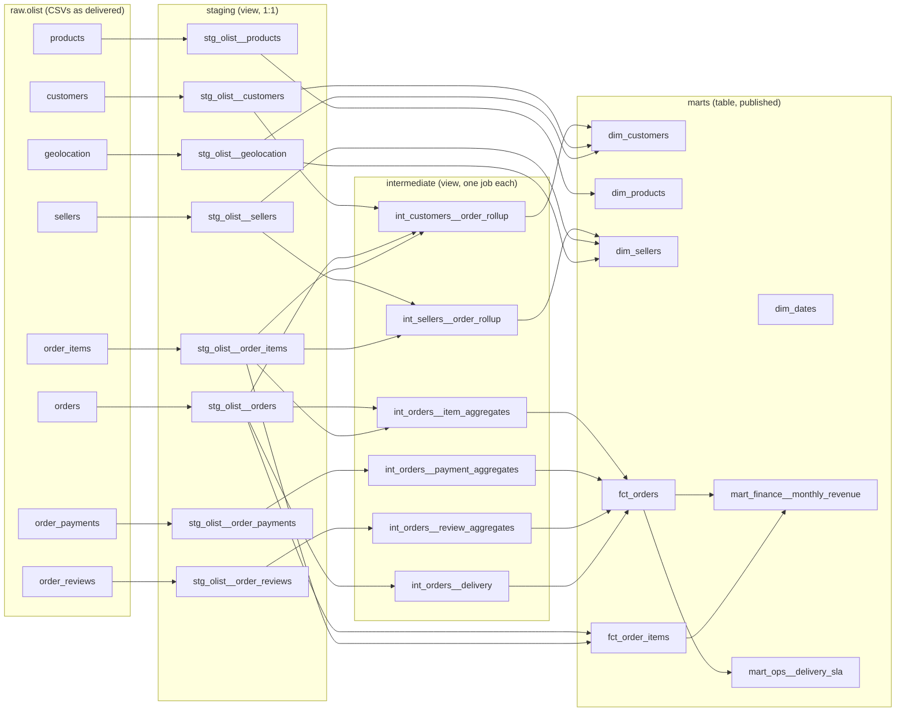

# Olist × dbt: project design plan

Goal: turn the Kaggle Brazilian E-Commerce Public Dataset by Olist (9 CSVs) into a layered dbt project with tests, contracts, CI and documentation. This is the implementation plan; the code lives alongside it.

All row counts below were measured against the downloaded CSVs, not estimated.

This plan was written before the build. Where the project outgrew it, the affected section now says so inline; §1 records the three items that moved from out of scope to delivered.

---

## 0. At a glance

- **Layers**: sources -> staging (view) -> intermediate (view) -> marts (table)
- **Core marts**: `dim_customers`, `dim_products`, `dim_sellers`, `dim_dates`, `fct_orders`, `fct_order_items`, `fct_payments`
- **Aggregates**: `mart_finance__monthly_revenue`, `mart_finance__payment_mix`, `mart_ops__delivery_sla`, `mart_seller__performance`, `mart_cx__review_delivery`
- **Also shipped**: Parquet exports for the dashboard, a Type 2 snapshot, and a metric dictionary
- **Three data traps to handle first**
  1. `customer_id` != `customer_unique_id`: 99,441 order-level ids map to 96,096 people
  2. `order_items` x `order_payments` double fan-out: the worst order is 21 item rows and 29 payments, which joins to 609 rows
  3. `geolocation` has many coordinates per zip prefix: 1,000,163 rows over 19,015 prefixes
- **Testing spine**: primary and composite key uniqueness on staging, relationships to dimensions, enum values, amount reconciliation across layers
- **Delivery**: 5 phases, each accepted on a green `dbt build` plus an explicit row-count check

---

## 1. Scope

**In scope**
- Land the 9 CSVs in `raw.olist` and declare them as sources
- Build staging -> intermediate -> marts, 29 models
- Data tests, unit tests and contracts, with primary key uniqueness covered everywhere it matters
- Separate dev and prod schemas, slim CI with state selection
- Documentation: every mart and every key column described, doc blocks reused

**Out of scope in the first draft, since delivered**

The draft held these back until the marts settled. All three landed later; each row records where it lives and what is still unfinished.

| Item | Status now | Where it lives |
|---|---|---|
| Semantic Layer | Drafted, not active | `docs/semantic_layer_draft.yml`, kept outside `models/` because MetricFlow needs a real `DATE` time dimension and the facts carry integer role-playing keys only. `docs/metric_dictionary.md` is the hand-maintained version that actually ships |
| Dashboards | Data feed delivered | `export_fct_orders`, `export_monthly_revenue` and `export_delivery_sla` write Parquet into `exports/`; the dashboard itself is outside the repo |
| Snapshots | Built and green | `snapshots/customers_snapshot.sql`, Type 2 on customer geography. The extract is static and has no natural SCD2 case, so one customer city is edited by hand to prove the mechanism |

**Still out of scope**
- Streaming ingestion
- Incremental models: the DuckDB load rebuilds in about 14 seconds, so incremental strategies would be practice for its own sake

---

## 2. Data and grain map

Grain first, SQL second. This table is the foundation of the project.

| Source CSV | One row is | Key | Watch out for |
|---|---|---|---|
| `olist_orders_dataset` | an order | `order_id` | 5 timestamp columns, 2,965 orders have no delivery date; `customer_id` is per order |
| `olist_order_items_dataset` | a product line in an order | `order_id` + `order_item_id` | `order_item_id` is a sequence, only unique in combination |
| `olist_order_payments_dataset` | a payment entry | `order_id` + `payment_sequential` | an order can be paid several times, up to 29 |
| `olist_order_reviews_dataset` | a review | `review_id` | `review_id` repeats 789 times in the raw data; an order can also have several reviews |
| `olist_customers_dataset` | a `customer_id` | `customer_id` | `customer_unique_id` repeats: the person key |
| `olist_sellers_dataset` | a seller | `seller_id` | geography joins through the zip prefix |
| `olist_products_dataset` | a product | `product_id` | 73 categories plus a blank; category names are Portuguese |
| `olist_geolocation_dataset` | a coordinate for a zip prefix | none | 1,000,163 rows, 19,015 prefixes, about 53 rows each |
| `product_category_name_translation` | a category | `product_category_name` | 71 rows; the file header carries a UTF-8 BOM |

**Enums** (verified against the data)

- `order_status`: `created` (5), `approved` (2), `invoiced` (314), `processing` (301), `shipped` (1,107), `delivered` (96,478), `canceled` (625), `unavailable` (609)
- `payment_type`: `credit_card` (76,795), `boleto` (19,784), `voucher` (5,775), `debit_card` (1,529), `not_defined` (3)
- `review_score`: 1 to 5

**Time range**: orders from 2016-09-04 to 2018-10-17. `dim_dates` generates a calendar padded around that range.

---

## 3. Layered architecture



Design rule: **aggregate each one-to-many child to order grain in intermediate, then join in `fct_orders`**. Items and payments never multiply each other.

---

## 4. Directory structure

```text
olist_dbt/
├── dbt_project.yml
├── packages.yml
├── profiles.yml                 # local only; no credentials to protect
├── models/
│   ├── staging/olist/
│   │   ├── _olist__sources.yml
│   │   ├── _olist__models.yml
│   │   └── stg_olist__*.sql     # 8 models
│   ├── intermediate/
│   │   ├── _int__models.yml
│   │   └── int_*.sql            # 6 models
│   └── marts/
│       ├── core/                # 6 dims and facts
│       ├── finance/             # monthly revenue
│       └── ops/                 # delivery SLA
├── macros/
│   └── generate_schema_name.sql
├── tests/                       # 5 singular assertions
├── load/
│   └── load_raw.sql
└── README.md
```

`dbt_project.yml` core block:

```yaml
name: 'olist'
version: '1.0.0'
config-version: 2

profile: 'olist'

models:
  olist:
    +materialized: view
    staging:
      +schema: staging
      +tags: ['staging']
    intermediate:
      +schema: intermediate
      +tags: ['intermediate']
    marts:
      +schema: marts
      +tags: ['marts']
      core:
        +materialized: table
```

---

## 5. Raw loading and source declarations

**Loading**: a single SQL script loads the 9 CSVs into `raw` with `read_csv_auto`, adding `_loaded_at` to every table. No renaming, no casting, no filtering at this layer.

**Why not seeds**: `geolocation` is a million rows, and seeds rebuild the whole table on every `dbt seed` while putting large CSVs in Git. Only the 71-row translation table would qualify, and mixing two ingestion paths for one source adds confusion.

**Sources**:

```yaml
version: 2

sources:
  - name: olist
    database: olist          # DuckDB catalog = the file name olist.duckdb
    schema: raw
    tables:
      - name: orders
        identifier: olist_orders_dataset
        loaded_at_field: _loaded_at
        freshness:
          warn_after: {count: 24, period: hour}
          error_after: {count: 72, period: hour}
      - name: order_items
        identifier: olist_order_items_dataset
      # ... one entry per CSV, with identifier mapping logical to physical names
```

`identifier` separates the logical table name from the physical file name, so models say `source('olist', 'orders')` and never carry the CSV naming.

Freshness is only meaningful if the data is reloaded on a schedule. For a one-off historical load, keep the declaration and widen the thresholds, or leave freshness out.

One file needs special handling: `product_category_name_translation.csv` starts with a UTF-8 BOM. `read_csv_auto` names the first column `\ufeffproduct_category_name`, the join then matches nothing, and every product category silently becomes `unknown` while its `not_null` test still passes. The loader therefore reads that file with explicit `columns`, and a sentinel test asserts more than 10 distinct categories exist.

---

## 6. Model inventory

### 6.1 staging (view)

One model per source table. Rename, cast, deduplicate, clean. No joins, except the category translation on `products`, because that is a dictionary.

| Model | Grain | Work done | Tests |
|---|---|---|---|
| `stg_olist__orders` | `order_id` | 5 timestamps cast, renamed to `purchased_at`, `approved_at`, `handed_to_carrier_at`, `delivered_to_customer_at`, `estimated_delivery_at` | `unique` + `not_null` on `order_id`; `not_null` on `purchased_at`; `accepted_values` on `order_status`; `relationships` to customers |
| `stg_olist__order_items` | `order_id` + `order_item_id` | ids cast to integer, money to `decimal(10,2)` | `unique_combination_of_columns`; `relationships` to orders, products, sellers; non-negative price and freight |
| `stg_olist__order_payments` | `order_id` + `payment_sequential` | money to `decimal(10,2)`, installments to integer | `unique_combination_of_columns`; `accepted_values` on `payment_type`; non-negative amount |
| `stg_olist__order_reviews` | `review_id` | **deduplicated to the latest row per `review_id`**, because the raw data repeats 789 ids up to 3 times | `unique` + `not_null` on `review_id`; `accepted_values` on `review_score` 1-5 |
| `stg_olist__customers` | `customer_id` | zip prefix zero-padded to a 5-character string, state uppercased | `unique` on `customer_id`; `not_null` on `customer_unique_id`; zip length 5; state length 2 |
| `stg_olist__sellers` | `seller_id` | zip prefix zero-padded | `unique` on `seller_id` |
| `stg_olist__products` | `product_id` | join the translation, `coalesce(category, 'unknown')`, cast dimensions | `unique` on `product_id`; `not_null` on `category_en` |
| `stg_olist__geolocation` | `zip_code_prefix` | **aggregated** to one row per prefix: mean lat/lng, `any_value` city and state; materialised as a table | `unique` on `zip_code_prefix`; `not_null` on lat/lng |

Staging example, with the adapter caveat noted inline:

```sql
with source as (
    select * from {{ source('olist', 'orders') }}
),

renamed as (
    select
        order_id,
        customer_id,
        order_status,
        cast(order_purchase_timestamp      as timestamp) as purchased_at,
        cast(order_approved_at             as timestamp) as approved_at,
        cast(order_delivered_carrier_date  as timestamp) as handed_to_carrier_at,
        cast(order_delivered_customer_date as timestamp) as delivered_to_customer_at,
        cast(order_estimated_delivery_date as timestamp) as estimated_delivery_at
    from source
)

select * from renamed
```

### 6.2 intermediate (view)

One job per model, grain stated in the filename and the header comment.

| Model | Output grain | Work done |
|---|---|---|
| `int_orders__item_aggregates` | `order_id` | item count, distinct products, distinct sellers, sum of price, sum of freight |
| `int_orders__payment_aggregates` | `order_id` | total paid, payment count, max installments, payment types |
| `int_orders__review_aggregates` | `order_id` | latest review by creation time, plus review count |
| `int_orders__delivery` | `order_id` | delivered flag, delivery days, estimated days, late flag, days late |
| `int_customers__order_rollup` | `customer_unique_id` | first and last order, order count, lifetime value, average order value, average review, most recent city and state |
| `int_sellers__order_rollup` | `seller_id` | order count, item count, revenue, freight, late rate (deduplicated to seller x order first) |

The late flag is the definition worth centralising, and the one worth a unit test:

```sql
case
    when delivered_to_customer_at is null then null      -- not delivered: neither on time nor late
    when delivered_to_customer_at > estimated_delivery_at then true
    else false
end as is_late
```

### 6.3 marts (table)

| Model | Grain / key | Contents |
|---|---|---|
| `dim_customers` | `customer_unique_id` | city, state, zip, lat/lng, first and last order, order count, one-time vs repeat, lifetime value, average order value, average review |
| `dim_products` | `product_id` | English category, weight (g and kg), three dimensions, volume in litres |
| `dim_sellers` | `seller_id` | city, state, zip, lat/lng, order count, item count, revenue, late rate |
| `dim_dates` | `date_day` | year, quarter, month, month start, day of week, weekend flag |
| `fct_orders` | `order_id` | customer keys, status, 5 timestamps, delivery metrics, item and payment rollups, review score |
| `fct_order_items` | `order_id` + `order_item_id` | surrogate key, product and seller keys, price, freight, purchase time, late flag |
| `mart_finance__monthly_revenue` | `month_start` + `category_en` | revenue, freight, order count, item count, revenue per order |
| `mart_ops__delivery_sla` | `month_start` + `state` | order count, delivered count, average delivery days, late rate |

`fct_orders` assembly, fan-out safe:

```text
stg_olist__orders
  left join int_orders__item_aggregates      on order_id   -- already one row per order
  left join int_orders__payment_aggregates   on order_id   -- already one row per order
  left join int_orders__review_aggregates    on order_id   -- already one row per order
  left join int_orders__delivery             on order_id
  left join stg_olist__customers             on customer_id
```

The three aggregates are what keep the fact at order grain. Joining the raw item and payment detail instead multiplies one order into 609 rows in the worst case measured.

Left joins plus `coalesce(..., 0)` matter for a second reason: 775 orders have no items, 1 has no payment, 768 have no review. Inner joins would silently drop them and the row-count assertion would fail.

---

## 7. Uniqueness and testing strategy

### 7.1 Uniqueness assertions

| Model | Assertion | Why |
|---|---|---|
| `stg_olist__orders` | `unique` + `not_null` on `order_id` | the order key everything downstream hangs on |
| `stg_olist__order_items` | `unique_combination_of_columns (order_id, order_item_id)` | neither column is unique alone |
| `stg_olist__order_payments` | `unique_combination_of_columns (order_id, payment_sequential)` | one order, several payments |
| `stg_olist__order_reviews` | `unique` on `review_id` | only true after deduplication; `order_id` is deliberately not unique here |
| `stg_olist__customers` | `unique` on `customer_id`, `not_null` on `customer_unique_id` | order key unique, person key repeated |
| `stg_olist__geolocation` | `unique` on `zip_code_prefix` | proves the aggregation is complete, otherwise joins fan out |
| `dim_customers` | `unique` + `not_null` on `customer_unique_id` | person grain |
| `fct_orders` | `unique` + `not_null` on `order_id` | the fact grain |
| `fct_order_items` | `unique_combination_of_columns (order_id, order_item_id)` | item grain |
| both monthly marts | `unique_combination_of_columns` on the two group-by keys | aggregates have a grain too |

### 7.2 Fan-out defences

Two rules:

1. Aggregate a one-to-many relationship to the target grain before joining, never in the detail layer.
2. Give every fact a grain assertion. If the row count of `fct_orders` differs from `stg_olist__orders`, something fanned out.

Reconciliation tests live in `tests/` and run as part of `dbt build`:

```sql
-- tests/assert_payment_total_reconciles.sql
-- No rows = pass. Rows = order-level totals disagree with the payment table.
with fct as (
    select sum(payment_total) as total from {{ ref('fct_orders') }}
),

payments as (
    select sum(payment_value) as total from {{ ref('stg_olist__order_payments') }}
)

select fct.total as fct_payment_total, payments.total as stg_payment_total
from fct, payments
where abs(coalesce(fct.total, 0) - coalesce(payments.total, 0)) > 0.01
```

The other four singular tests: row count parity for `fct_orders`, item value reconciliation, `dim_customers` row count equals distinct people, and the category translation sentinel.

### 7.3 Unit tests

Worth writing where logic branches, not where a model projects columns:

- `int_orders__delivery.is_late`: not delivered, on time, late
- any status grouping added later
- anything reading `current_date` or `current_timestamp`, which must be pinned so the expected output does not change daily

```yaml
unit_tests:
  - name: is_late_handles_boundary
    model: int_orders__delivery
    given:
      - input: ref('stg_olist__orders')
        rows:
          - {order_id: 'a1', delivered_to_customer_at: '2018-01-10 10:00:00', estimated_delivery_at: '2018-01-10 00:00:00'}
          - {order_id: 'a2', delivered_to_customer_at: '2018-01-09 23:59:00', estimated_delivery_at: '2018-01-10 00:00:00'}
          - {order_id: 'a3', delivered_to_customer_at: null, estimated_delivery_at: '2018-01-10 00:00:00'}
    expect:
      rows:
        - {order_id: 'a1', is_late: true}
        - {order_id: 'a2', is_late: false}
        - {order_id: 'a3', is_late: null}
```

### 7.4 Contracts

Set `contract: enforced: true` on `dim_customers`, `fct_orders` and `fct_order_items`, declaring column names and types. dbt checks that the columns exist and the types match at build time. Column order is not checked and length is not checked separately, so a size goes into the declared type.

A platform difference worth knowing: Snowflake and BigQuery accept `primary_key` and `foreign_key` declarations but do not enforce them, while `not_null` is enforced. Value-level guarantees still come from data tests; contracts guarantee shape.

### 7.5 What not to test

- `accepted_values` on a 73-value category column: maintenance cost outweighs the signal
- `not_null` on `delivery_days` for undelivered orders: null is the correct value
- unit tests on staging models that only rename columns

---

## 8. Materialisation and incremental strategy

| Layer | Materialisation | Reason |
|---|---|---|
| staging | `view` | light, always reflects the latest raw data, free to rebuild in dev |
| staging (`geolocation`) | `table` | it aggregates a million rows; a view would rescan on every join |
| intermediate | `view` | easy to debug one step at a time |
| dims | `table` | queried repeatedly by BI |
| facts | `table` | static historical data; see below |
| aggregates | `table` | small results, frequent queries |

**Honest note on incremental**: Olist is a 2016-2018 static extract with no new rows arriving, so incremental models bring no real benefit here. They demonstrate the mechanism and nothing more. Therefore:

- everything is a `table` for correctness
- `fct_order_items` carries a commented incremental block as a reference: `delete+insert` with `unique_key (order_id, order_item_id)` and a lookback window
- if you practise `append`, remember it is not idempotent: rerunning a window duplicates rows

On DuckDB, `append` and `delete+insert` work; `merge` depends on the dbt-duckdb version; `microbatch` belongs to BigQuery or Snowflake.

---

## 9. Environments, schemas and CI

### 9.1 Schema strategy

- **dev**: one target schema per developer, e.g. `dbt_zhang`, expanded to `dbt_zhang_staging` and `dbt_zhang_marts`
- **prod**: bare layer names, `staging` and `marts`

The macro prevents the classic `prod_staging_staging` concatenation:

```sql

    
    
        {{ default_schema }}
    
        {{ custom_schema_name | trim }}
    
        {{ default_schema }}_{{ custom_schema_name | trim }}
    

```

### 9.2 CI

```bash
dbt deps
dbt clone --state prod-artifacts/ --select state:modified+ --target ci
dbt build --select state:modified+ --defer --state prod-artifacts/
```

- `state:modified+` limits the run to changed models and their downstream
- `dbt clone` copies production relations into the CI schema without duplicating storage, so incremental models do not have to be rebuilt from scratch
- `--defer` makes unchanged upstream models resolve to the production relations

DuckDB has no `dbt clone`, so on this setup CI can only run a full rebuild. That is a platform limit, not a configuration gap.

### 9.3 Production job

```bash
dbt source freshness
dbt build --target prod
```

Order matters: freshness fails first and cheaply, before spending warehouse time rebuilding marts on stale inputs.

---

## 10. Naming and conventions

- staging: `stg_<source>__<entity>`, double underscore between source and entity
- intermediate: `int_<entity>__<verb>`, e.g. `int_orders__payment_aggregates`
- marts: `dim_`, `fct_`, or `mart_<domain>__<thing>`
- CTE order: import CTEs (`select * from ref`), then logical CTEs (one job each), then the final projection
- timestamps: read as local time, no timezone conversion, and the assumption is stated in the model description
- money: BRL as `decimal(10,2)`, never float

---

## 11. Roadmap

| Phase | Output | Acceptance |
|---|---|---|
| 0. Environment (0.5 day) | repo, `dbt_project.yml`, `profiles.yml`, loader, 9 tables in `raw` | `dbt debug` passes, every table has rows |
| 1. Sources and staging (1 day) | 8 staging models with uniqueness, relationship, enum and expression tests | `dbt build --select staging` green |
| 2. Order-grain aggregation (1 day) | 4 `int_orders__*` models plus `fct_orders` | `fct_orders` row count equals orders; payment total reconciles |
| 3. Full marts (1-2 days) | dims, `fct_order_items`, 2 aggregates, contracts | every grain assertion passes, docs generated |
| 4. Industrialisation (1 day) | CI, production job, incremental reference, unit tests | CI runs only changed models; incremental rerun is idempotent |

Run the row-count and amount checks at the end of each phase rather than saving them for the end.

---

## 12. Acceptance criteria

- `dbt build` green with zero failures
- `count(fct_orders)` == `count(stg_olist__orders)` → both 99,441
- `count(fct_order_items)` == `count(stg_olist__order_items)` → both 112,650
- `sum(fct_orders.payment_total)` vs `sum(stg_olist__order_payments.payment_value)`, difference under 0.01
- `sum(fct_orders.items_value)` equals `sum(stg_olist__order_items.price)`
- `count(dim_customers)` == `count(distinct customer_unique_id)` → 96,096
- `count(stg_olist__geolocation)` == `count(distinct zip_code_prefix)` → 19,015
- every mart has a model description and a description on its key columns

---

## 13. Risks and open decisions

**Known risks**

1. Using `customer_id` as the customer key inflates the customer count and makes repeat purchase rate permanently zero. Use `customer_unique_id`.
2. Joining payment and item detail at the detail layer inflates amounts while the uniqueness assertions still pass, because the joined grain is genuinely unique. Only amount reconciliation catches it.
3. Inconsistent zip prefix types (integer versus zero-padded string) break the geolocation join and leave city and state null.
4. Undelivered orders have null timestamps, so delivery days and late flags must be null-aware rather than defaulting to zero.
5. Several reviews per order inflate order counts if joined directly.
6. Time zone: no conversion, every month is a local-time calendar month.

**Open decisions**

- Warehouse: DuckDB locally today; BigQuery or Snowflake would add `dbt clone` and full incremental strategies
- Semantic Layer: drafted in `docs/semantic_layer_draft.yml`. The blocker is a `DATE` time dimension on the facts, not the modelling
- Whether to declare exposures: the dashboard reads `exports/*.parquet` directly, so nothing links that report back to these models
- Whether a genuinely incremental source is needed for the practice to be realistic

---

## 14. Kimball conformance

The marts layer was revised to follow Kimball's dimensional method; the detailed specification lives in [docs/kimball_model.md](docs/kimball_model.md).

What changed from the first draft of this plan:

- Surrogate keys: `customer_key`, `product_key`, `seller_key` (md5 of the natural key) and `date_key` (integer YYYYMMDD) are now the primary keys of the dimensions. Source identifiers remain as alternate keys and are still tested for uniqueness.
- Role-playing date dimensions: `fct_orders` carries five date keys (purchase, approval, carrier handover, delivery, promised) and `fct_order_items` carries two (purchase, shipping limit). Reporting months are resolved by joining `dim_dates`, not by truncating a timestamp.
- Unknown member: `dim_dates` has `date_key = 0` dated 1900-01-01. The 2,965 orders without a delivery date use it, so fact foreign keys are never null.
- Degenerate dimensions: `order_id` and `order_item_id` stay in the facts without their own dimension.
- Star, not snowflake: category attributes live inside `dim_products`; latitude and longitude live inside `dim_customers` and `dim_sellers`.
- Bus matrix and the four-step design record are in the design doc, along with the deliberate deviations (derived attributes in dimensions, no review-grain fact yet, Type 2 history in a snapshot rather than in the marts).

